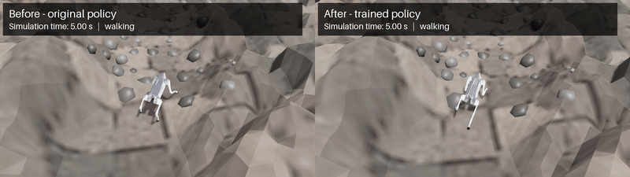

# Go2 Rocky Locomotion

A Unitree Go2 learning to climb fixed, uneven rocky hillsides in [Newton](https://github.com/newton-physics/newton), built on
[NVIDIA Warp](https://github.com/NVIDIA/warp) with rigid body dynamics and contacts in MuJoCo Warp. The terrain is a combination of a procedural mountain heightfield, fractured bedrock and embedded convex rock outcrops. The slopes are real geometry, world gravity is still vertical.

This repository is a fork of
[newton-terrain](https://github.com/prakash-aryan/newton-terrain). It extends
The Go2 experimentation workflow is to do rigid rocky slopes with PPO fine-tuning, paired evaluation, trajectory analysis and video recording. The inherited sand/snow implementation is still available in `newton_terrain/`; the rocky environment uses its own rigid contact implementation.


<table>
<tr>
<td></td>
</tr>
<tr>
<td align="center">Before and after PPO fine-tuning on the same rocky uphill, at a 0.6 m/s command.</td>
</tr>
</table>

### Before and after training

The original pretrained walking policy is compared with the fine-tuned actors on identical terrain, initial poses, commands, and goals. The video shows seed 102: the final rocky policy reached 5.01 m in 12.56 s of walking and gained 1.17m at base elevation, the original policy had been stuck at just about 1m.

Initial held-out evaluation: mountain seeds 101–103, medium roughness, a 0.6m/s command, 5m goal, 20s walk limit.

| Policy | Mean final progress |
| --- | ---: |
| Original pretrained | 0.96 m |
| Gentle-slope fine-tuned | 0.67 m |
| Final rocky-terrain fine-tuned | 1.80 m |

The final actor dropped after 0.20m on each of the other two seeds, performing worse on those than on the original. That's just a partial result from one training seed and three evaluation terrains, not any kind of reliable mountain traversal. Raw trajectories and results are included in [`runs/eval/climb_seed11_mountain/`](runs/eval/climb_seed11_mountain/).

## Quick start

Requires Linux, an NVIDIA GPU with CUDA, Python 3.12+, and
[uv](https://docs.astral.sh/uv/). Tested on an RTX 5090 **Laptop** GPU with
24 GB VRAM and driver 595.99.02.

```bash
git clone https://github.com/yahyamomtaz/go2-rocky-locomotion.git
cd go2-rocky-locomotion
uv sync --locked
```

The base environment pins Newton 1.6.0 and Warp 1.18.0; MuJoCo/MuJoCo Warp
3.12.0 are resolved in `uv.lock`. The Go2 model and original walking policy
are downloaded from Newton's asset cache on first use. The derived rocky
policies are included in `runs/train/`. Run commands from the repository root.

```bash
# Optional training and recording dependencies.
uv sync --locked --extra train --extra video
```

The training extra uses PyTorch 2.12.0 with CUDA 13.0 and rsl-rl 5.5.1.
The video extra supplies ImageIO and an FFmpeg encoder. These extras are not
required to run an existing ONNX actor in the viewer.

## Usage

### Walk the Go2 on rocky slopes

```bash
# Live: the trained actor on the successful held-out example.
uv run python -m go2_rocky.run_go2 --terrain mountain --seed 102 --speed 0.6 \
  --policy runs/train/climb_seed11_rocky/policy.onnx --camera follow

# Headless baseline: the original pretrained actor on the same mountain.
uv run python -m go2_rocky.run_go2 --terrain mountain --seed 102 --speed 0.6 \
  --seconds 20 --viewer null --log runs/before.npz

# Headless trained actor, with matching settings.
uv run python -m go2_rocky.run_go2 --terrain mountain --seed 102 --speed 0.6 \
  --seconds 20 --viewer null --policy runs/train/climb_seed11_rocky/policy.onnx \
  --log runs/after.npz
```

Main options of `go2_rocky.run_go2`:

| Option | Effect |
| --- | --- |
| `--terrain smooth\|rocky\|mountain` | Finite smooth slope, planar rock field, or mountain (default). |
| `--slope-deg 15` | Planar inclination, or target trail grade on a mountain; local mountain grades vary. |
| `--direction uphill\|downhill\|cross` | Planar travel direction; mountain mode follows its uphill route. |
| `--roughness low\|medium\|high`, `--seed N` | Seeded physical relief and rock layout. |
| `--surface-rockiness 1`, `--rock-count N` | Mountain heightfield relief multiplier and separate rock count. |
| `--friction 0.75` | Supporting-surface friction coefficient. |
| `--policy policy.onnx` | Compatible 48-observation, 12-action ONNX actor; omit for the original actor. |
| `--speed 0.6`, `--seconds 20` | Path speed command and maximum walking duration after settling. |
| `--goal-distance 0` | Disable the distance goal to continue walking for the requested duration. Falls still terminate. |
| `--camera follow\|wide\|free` | Robot-centred tracking, mountain overview, or manual camera control. |
| `--camera-distance 3` | Follow-view horizontal distance in metres; increase to zoom out. |
| `--viewer null`, `--log run.npz` | Headless physics and saved joint/base/contact trajectories. |
| `--video clip.mp4`, `--headless` | Record an OpenGL view, optionally without showing a window; use the video extra. |

The default goal is 5 m on a mountain. `--seconds` excludes the initial 1 s
settling period. Speed is a command, not a guaranteed measured speed.
To render the saved paired trajectories with larger labels and the wider
follow camera, without opening a viewer window:

```bash
uv run --extra video python -m go2_rocky.record_video \
  --before runs/eval/climb_seed11_mountain/original_seed102.npz \
  --after runs/eval/climb_seed11_mountain/trained_seed102.npz \
  --camera-distance 3 --text-scale 2 --output runs/videos/my_comparison.mp4
```

This saves the comparison and separate `_before.mp4` / `_after.mp4` clips.
The shorter side holds its labelled final frame. Defaults are 30 fps and
1280×720 per clip; `--fps`, `--width`, and `--height` adjust the output.
Use a new filename for each recording. To record a new simulation directly:

```bash
uv run --extra video python -m go2_rocky.run_go2 --terrain mountain --seed 102 \
  --speed 0.6 --seconds 20 --policy runs/train/climb_seed11_rocky/policy.onnx \
  --camera follow --headless --video runs/videos/new_after.mp4
```

Omit `--headless` to watch while recording. OpenGL is required even for
headless rendering. Replaying saved trajectories preserves the evaluated
motion; a new GPU simulation can differ slightly.

### Analyse runs

```bash
# Compare original and trained actors on unseen terrain seeds.
uv run python -m go2_rocky.evaluate_policies \
  --policy original=pretrained --policy trained=runs/train/climb_seed11_rocky/policy.onnx \
  --terrain mountain --seeds 104 105 106 --output runs/eval/new_seeds

# Plot saved progress, body tilt, foot clearance, and commands.
uv run python -m go2_rocky.analyze_trajectory runs/before.npz runs/after.npz \
  --output runs/trajectory_review --plot

# CPU geometry/contact/interface checks; CUDA training checks are opt-in.
PYTEST_DISABLE_PLUGIN_AUTOLOAD=1 uv run --extra train --extra video python -m pytest -q
```

The standard suite passed 109 tests with one opt-in CUDA test skipped. The
CUDA training checks also passed, covering settled contacts, selective
resets, pretrained actor equivalence, and export. Evaluation preserves the
same initial pose and collision geometry across policies, with separate
success, fall, and timeout outcomes. Use more terrain and training seeds
before making reliability claims.

### Train a policy

```bash
# 1. Install training dependencies and benchmark the actual GPU.
uv sync --locked --extra train
uv run --extra train python -m go2_rocky.train_ppo --benchmark --envs 512 \
  --stage rocky --surface-rockiness 1 --roughness medium --name hardware_benchmark

# 2. Train on gentle slopes, steeper slopes, then fractured rocky slopes.
NUM_ENVS=512 TRAINING_PREFIX=rocky_v2 bash scripts/train_curriculum.sh

# 3. Evaluate the resulting ONNX actor on held-out mountains.
uv run python -m go2_rocky.evaluate_policies \
  --policy original=pretrained --policy trained=runs/train/rocky_v2_rocky/policy.onnx \
  --terrain mountain --seeds 104 105 106 --output runs/eval/rocky_v2
```

The first curriculum used 250 + 500 + 1,000 PPO updates at 512 parallel worlds,
including 25 critic-only warmup updates per stage. It collected 21.5 million
transitions and took **22.2 minutes of learning**, plus about 20 s of setup,
on the RTX 5090 Laptop GPU. Sustained runs projected roughly 18–22 minutes
per 1,500 updates on that setup; this is compute time, not time to convergence.

The final ONNX/TorchScript actors and full PPO checkpoint are included in
`runs/train/climb_seed11_rocky/`. `policy.onnx` is for the viewer; `policy.pt`
is an actor-only TorchScript export for initializing a new training stage.
`checkpoint.pt` additionally contains the critic, optimizer, and iteration
state. Continue the final stage into a new run directory with:

```bash
uv run --extra train python -m go2_rocky.train_ppo \
  --stage rocky --max-slope 25 --roughness medium --surface-rockiness 1 \
  --rock-count 48 --envs 512 --iters 1500 --warmup 0 --seed 11 \
  --resume runs/train/climb_seed11_rocky/checkpoint.pt --name rocky_continued

uv run --extra train tensorboard --logdir runs/train
```

Run names must be unique. The curriculum budgets can be changed with
`GENTLE_ITERS`, `SLOPE_ITERS`, and `ROCK_ITERS`. Each run records configuration,
terrain, timing, checkpoint hashes, and TensorBoard metrics. Resume starts
fresh simulated episodes rather than restoring an exact simulator/RNG state.
Interrupt signals request a save after the current chunk of up to 25 updates.

[`scripts/train_slurm.sh`](scripts/train_slurm.sh) is a one-GPU Slurm template.
Adjust its account, partition, driver/modules, and GPU request for your HPC.
Install the locked training extra and pre-cache Go2 assets on a networked
node before using offline compute nodes. Use separate jobs for training seeds;
this entry point does not enable distributed multi-GPU training.

## Repository layout

```text
go2_rocky/                  rocky-terrain simulation and learning
  terrain.py               analytic slope geometry and coordinate frames
  mountain.py, surface.py  mountain heightfield and fractured bedrock
  rocks.py                 fixed convex rock generation and placement
  run_go2.py               pretrained/trained ONNX policy execution
  controller.py            bounded path-tracking velocity commands
  rl_env.py, rewards.py    parallel rigid-contact training environment
  train_ppo.py             PPO fine-tuning, checkpoints, and policy export
  evaluate_policies.py     paired multi-seed evaluation
  analyze_trajectory.py    recorded-grid and foot-clearance analysis
  camera.py, video.py      follow camera and MP4 encoding
  record_video.py          headless replay and before/after composition
scripts/
  train_curriculum.sh      staged slope/rock training
  train_slurm.sh           example single-GPU HPC job
tests/                     geometry, contacts, policy interface, and camera tests
runs/
  train/climb_seed11_*/    derived actors and training metadata
  eval/climb_seed11_mountain/  archived paired trajectories and results
docs/media/comparison_b_2.gif  README comparison
README.md                  setup, training, recording, and attribution
newton_terrain/             inherited upstream sand/snow implementation
```

The original sand/snow scripts, calibration table, policies, and media are
retained from the fork. New experiment outputs are ignored by Git; the
included climbing policies, evaluation snapshot, and README GIF are curated
exceptions.

## Third-party components

- **newton-terrain:** upstream project by
  [prakash-aryan](https://github.com/prakash-aryan/newton-terrain), from which
  this repository was forked. Its original sand/snow implementation is retained.
- **Newton, NVIDIA Warp, MuJoCo Warp, warp_nn:** Apache-2.0.
- **PyTorch, rsl-rl:** BSD-3-Clause.
- **OpenSimplex:** MIT; used for procedural mountain elevations.
- **Unitree Go2 model:** downloaded from newton-assets, BSD-3-Clause (Unitree Robotics).
- **Pretrained Go2 walking policy:** newton-assets, Apache-2.0. The included
  climbing actors are fine-tuned derivatives; its license is in
  [`runs/train/LICENSE`](runs/train/LICENSE).
- **ImageIO / FFmpeg:** optional video encoding dependencies, with their
  respective upstream license notices distributed in the installed packages.

The Go2 USD model and original actor are fetched with
`newton.utils.download_asset("unitree_go2")`; they remain in Newton's cache.
The rocky actors initialize from its `rl_policies/mjw_go2.pt` weights and
are exported to ONNX for evaluation. Actor initialization and exports are
checked against the evaluation runtime. Trajectories and training manifests
record checkpoint hashes and dependency versions; the included results and
timings are summarized in [`runs/training_validation.json`](runs/training_validation.json).
Mountain elevations and rock meshes are procedural, without satellite data
or scanned rock assets. The added rigid-slope environment does not incorporate
the inherited sand proxy or MPM dynamics.
