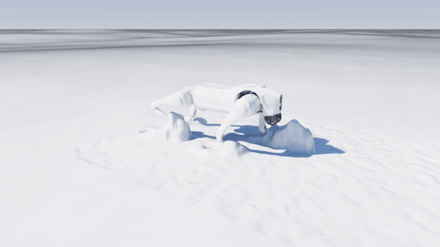
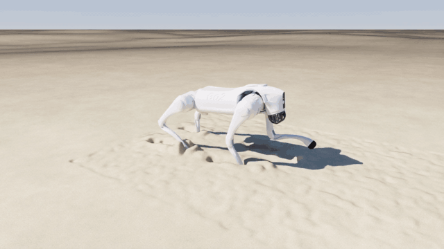
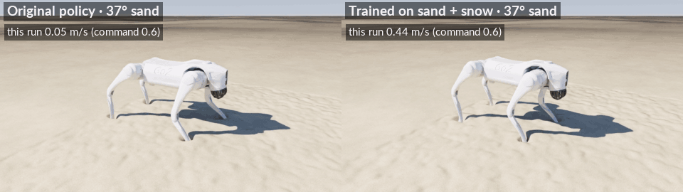
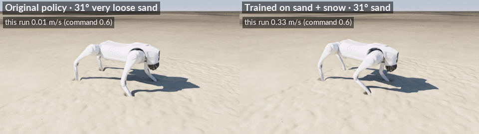
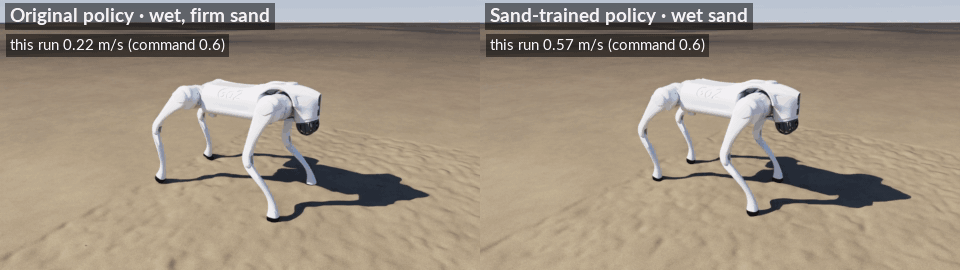
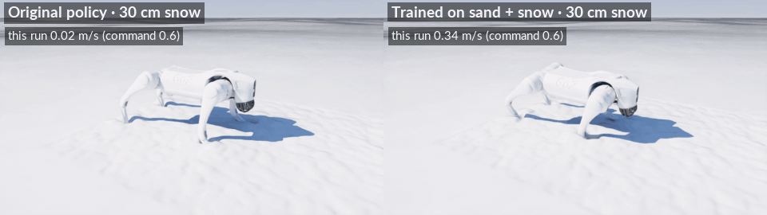
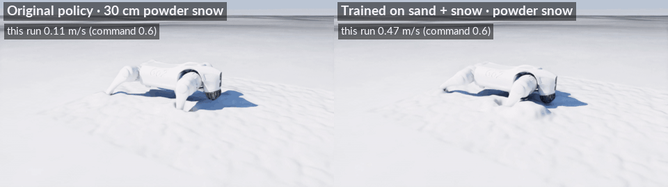

# Go2 on sand and snow (NVIDIA Warp / Newton)

A Unitree Go2 walking on deformable ground: loose, dense, damp and wet sand, and settled, powder and packed snow.
The terrain is a two-way coupled material-point (MPM) simulation in [Newton](https://github.com/newton-physics/newton),
built on [NVIDIA Warp](https://github.com/NVIDIA/warp), and the robot runs in MuJoCo Warp. A policy trained on rigid
ground bogs down in loose sand and deep snow; a few minutes of PPO fine-tuning in a fast Warp terrain model gives a
gait that walks through both.

<table>
<tr>
<td></td>
<td></td>
</tr>
<tr>
<td align="center">Final policy, settled snow 15 cm deep</td>
<td align="center">Final policy, loose sand 37°</td>
</tr>
</table>

### Before and after training

The original policy (trained on rigid ground) against the fine-tuned ones on the same terrain, at a 0.6 m/s command.

**Sand**







**Snow**





## Quick start

Requires Linux, an NVIDIA GPU with CUDA (tested on an RTX 5070 Ti, 16 GB, CUDA 13) and [uv](https://docs.astral.sh/uv/).

```bash
git clone https://github.com/prakash-aryan/newton-terrain.git
cd newton-terrain
uv sync
```

`uv sync` installs Newton 1.6 (with Warp 1.18 and MuJoCo Warp 3.12), PyTorch 2.12 (CUDA 13.0 build), rsl-rl 5.5.1
and this package. The Go2 model and Newton's pretrained Go2 policy are downloaded automatically on first run. Run
all commands from the repository root.

## Usage

### Walk the Go2 on sand or snow

```bash
# Live, in Newton's OpenGL viewer: final policy in 30 cm of settled snow
uv run python scripts/go2_sand.py --snow settled --sand-depth 0.3 --policy runs/train/snow_v3_all/policy.pt

# Headless with a log: original policy on 37 degree sand, 2 m wide bed, sand sample 1
uv run python scripts/go2_sand.py --viewer null --friction 0.75 --sand-depth 0.3 --patch 2.0 4.5 --seed 1 \
    --log runs/test.npz

# Final policy on the same sand
uv run python scripts/go2_sand.py --viewer null --friction 0.75 --sand-depth 0.3 --patch 2.0 4.5 --seed 1 \
    --policy runs/train/snow_v3_all/policy.pt --log runs/test_final.npz
```

Main options of `scripts/go2_sand.py`:

| Option | Effect |
|---|---|
| `--friction 0.6 ... 1.0` | sand strength (friction coefficient; 0.6 = 31°, very loose, 1.0 = 45°, dense) |
| `--cohesion <Pa>` | damp or wet sand (Newton's knob; about 4000 per kPa of cohesion) |
| `--snow settled\|powder\|packed` | snow instead of sand |
| `--sand-depth <m>` | thickness of the sand or snow layer over a hard floor |
| `--rigid` | rigid ground instead |
| `--policy <policy.pt>` | TorchScript policy; default is Newton's pretrained (rigid-ground) Go2 policy |
| `--speed <m/s>`, `--seconds <s>` | forward command and run length |
| `--patch <w> <l>`, `--seed <n>` | bed size and random particle packing |
| `--log <file.npz>` | save base, joint and foot trajectories |

### Analyse runs

```bash
uv run python scripts/go2_analyze.py runs/test.npz runs/test_final.npz   # speed, sinkage, slip, power, cost of transport
uv run python scripts/go2_analyze.py --summary runs/my_eval/*.npz       # mean and spread over seeds
```

### Train a policy

```bash
# 1. Calibrate the fast terrain model: kinematic foot and shin tests in the MPM, one per terrain type
uv run python scripts/mpm_intruder_test.py --friction 0.75 --out runs/intruder_f0.75.npz
uv run python scripts/mpm_intruder_test.py --snow settled --out runs/intruder_snow_settled.npz

# 2. Fit the fast model's coefficients from those tests (writes runs/proxy_table.json)
uv run python scripts/fit_proxy_table.py

# 3. PPO fine-tuning (about 5 minutes each on an otherwise idle GPU): a sand policy, then sand + snow from it
uv run python scripts/train_sand.py --types f0.6 f0.75 f0.9 f1.0 f0.75_c2000 f0.75_c4000 f0.75_c8000 --name sand_v1
uv run python scripts/train_sand.py --init-policy runs/train/sand_v1/policy.pt --term-height 0.0 \
    --snow-sb-range 0.2 0.3 --snow-sh-range 0.8 1.5 --name snow_v3_all

# 4. Evaluate it in the full MPM simulation
uv run python scripts/go2_sand.py --viewer null --snow settled --sand-depth 0.3 --patch 2.0 4.5 \
    --policy runs/train/snow_v3_all/policy.pt --log runs/eval.npz
```

The fitted table (`runs/proxy_table.json`) and both policies are included, so steps 1 and 2 are optional. The
terrain types are `f0.6`, `f0.75`, `f0.9`, `f1.0` (sand friction), `f0.75_c2000/4000/8000` (damp to wet sand) and
`snow_settled`, `snow_powder`, `snow_packed`.

## How it works

- **Terrain.** Newton's implicit MPM: about 850,000 material points in a 2 m x 4.5 m x 30 cm bed, Drucker-Prager sand
  (optionally cohesive) or compactable snow, two-way coupled to the robot in MuJoCo Warp through
  `SolverCoupledProxy`.
- **Fast training model.** `newton_terrain/sand_proxy.py` is a Warp kernel that applies the terrain forces to each leg
  (foot bearing with footprint memory, drag, shin and thigh drag, pull-out), fitted per terrain type from the MPM
  tests above.
- **Training.** `newton_terrain/go2_proxy_env.py` runs 4096 Go2s in parallel with the physics step captured as a CUDA
  graph, at about 500,000 policy steps per second (the MPM runs one robot at under 0.1x real time).
  `scripts/train_sand.py` fine-tunes Newton's pretrained Go2 policy with PPO (rsl-rl); the critic also sees the
  terrain parameters.
- **Evaluation.** Policies are judged only in the full MPM simulation.

The GIFs are path-traced renders of the MPM runs; the rendering tools are not part of this repository.

## Repository layout

```
newton_terrain/            library
  sand_proxy.py            fast Warp terrain contact model (sand and snow) and fitting its coefficients
  go2_proxy_env.py         multi-world Go2 training environment on the fast model (rsl-rl VecEnv)
scripts/
  go2_sand.py              Go2 on MPM sand or snow (two-way coupled), or rigid ground
  go2_analyze.py           gait metrics and multi-seed summaries
  mpm_intruder_test.py     kinematic foot and shin push, drag and pull tests in the MPM
  fit_proxy_table.py       fits the fast model's coefficients from those tests
  train_sand.py            PPO fine-tuning; exports a TorchScript policy (48 inputs to 12 joint targets)
runs/
  proxy_table.json         fitted fast-model coefficients for the 10 terrain types
  train/sand_v1/policy.pt  sand policy
  train/snow_v3_all/policy.pt  final sand + snow policy
docs/media/                README GIFs
```

## Third-party components

- **Newton, NVIDIA Warp, MuJoCo Warp, warp_nn:** Apache-2.0.
- **PyTorch, rsl-rl:** BSD-3-Clause.
- **Unitree Go2 model:** downloaded from newton-assets, BSD-3-Clause (Unitree Robotics). Not included here.
- **Pretrained Go2 walking policy:** newton-assets, Apache-2.0. The policies in `runs/train/` are fine-tuned from it.
